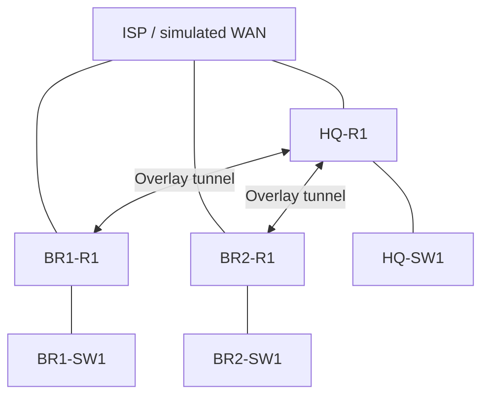
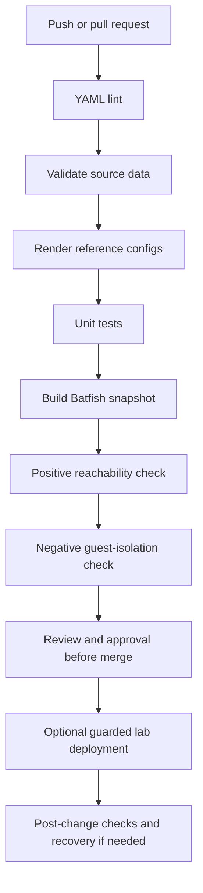

# P3 — Network-as-Code with a GitOps Workflow

**Project:** Secure multi-site SME network (HQ + two branches)
**Date:** 14 October 2026
**Status:** Local validation, rendering, unit tests, and Batfish policy checks completed on 14 October 2026. GitHub-hosted CI is expected to run after the final push; live-device deployment was not executed.

## Abstract

This project models a segmented small-to-medium enterprise network with a headquarters (HQ) and two branch sites using a Network-as-Code workflow. Network intent is stored in YAML, rendered into IOS-style reference configurations with Jinja2, and checked through automated data validation and unit tests. Git and pull requests provide change history and review gates. Batfish is included for model-based reachability validation, and an optional guarded Ansible workflow is provided for deployment and recovery on compatible SSH-accessible network devices.

The key objective is to make proposed changes reviewable and testable before they are applied. Packet Tracer is used as the educational network simulator, but it is not treated as a standard SSH/API deployment target. Generated CI configurations are reference candidates and must not be pasted into live devices as complete replacement configurations.

## 1. Problem statement and objectives

Manual device-by-device changes can cause configuration drift, inconsistent ACLs, addressing mistakes, accidental loss of connectivity, and difficult recovery. A command can be syntactically valid while violating the intended network security policy. This project therefore seeks to:

- Maintain one structured source of truth for shared addressing, VLANs, site information, and security intent.
- Render repeatable device configuration candidates using templates rather than manually duplicating CLI text.
- Validate the source data and generated configuration before proposing a network change.
- Use Git branches and pull requests for traceable review.
- Test both permitted and prohibited traffic flows so a broken model does not pass merely because all traffic is blocked.
- Keep deployment and rollback guarded, with deployment enabled only for a compatible, explicitly verified lab.

## 2. Network overview

The modeled topology contains seven devices: HQ-R1, HQ-SW1, BR1-R1, BR1-SW1, BR2-R1, BR2-SW1, and ISP. Each site uses separate VLANs for staff, servers, guests, and management. VLAN 999 is reserved as an unused/parking VLAN on access switches.

| Site | Staff VLAN 10 | Server VLAN 20 | Guest VLAN 30 | Management VLAN 99 |
|---|---|---|---|---|
| HQ | 10.10.10.0/24 | 10.10.20.0/24 | 10.10.30.0/24 | 10.10.99.0/24 |
| Branch 1 | 10.20.10.0/24 | 10.20.20.0/24 | 10.20.30.0/24 | 10.20.99.0/24 |
| Branch 2 | 10.30.10.0/24 | 10.30.20.0/24 | 10.30.30.0/24 | 10.30.99.0/24 |

The reference design uses separate WAN /30 networks, a hub-and-spoke overlay between HQ and both branches, OSPF for routing, and NAT for selected data VLANs. The ISP device represents the simulated WAN edge; a modeled loopback test target is not proof of connectivity to the public Internet.

### Logical topology

## 3. Network-as-Code design

The repository separates intent, rendering, validation, review, and optional deployment:

- **Source of truth:** `data/global.yml` and `data/sites.yml` hold shared settings, addressing, site identity, and policy.
- **Templates:** `templates/router.j2`, `templates/switch.j2`, and `templates/isp.j2` generate candidate reference configurations.
- **Validation:** `scripts/validate_data.py` checks structure and invariants in the source data. Jinja2 rendering fails on missing required values. Pytest verifies selected policy, rendering behaviour, reconciliation corrections, and deployment safety gates.
- **Network analysis:** `scripts/build_batfish_snapshot.py` creates the model used by Batfish. `scripts/batfish_validate.py` checks reachability assertions.
- **Change management:** branches and pull requests provide diffs, review, and a traceable merge history.
- **Deployment and recovery:** optional Ansible playbooks are guarded and intended only for a compatible SSH-accessible lab after credentials, backups, supported commands, and rollback have been independently verified.

### CI workflow

CI-mode output uses synthetic test values. It must not be treated as a production secret set or deployed configuration. A GitHub-hosted runner ordinarily cannot reach a private lab behind a home router; device deployment would require a properly secured self-hosted runner or another deliberately designed management path.

## 4. Reconciliation findings

The supplied P1 running configurations revealed several inconsistencies. The desired-state model accounts for these as explicit corrections rather than silently claiming that the original devices already had the corrected state.

| Device | Observed issue | Desired-state correction |
|---|---|---|
| BR1-R1 | Staff DHCP pool used the guest VLAN gateway and the guest pool was absent | Site-specific STAFF and GUEST pools use `10.20.10.1` and `10.20.30.1` respectively |
| BR2-R1 | Tunnel1 did not show a destination | Model defines the HQ WAN endpoint `203.0.113.2` |
| BR1-SW1 | Management SVI used HQ's management subnet | Uses `10.20.99.2/24`, gateway `10.20.99.1` |
| BR2-SW1 | Management SVI used HQ's management subnet | Uses `10.30.99.2/24`, gateway `10.30.99.1` |
| BR2-SW1 | Trunk policy was incomplete/inconsistent | Model uses native VLAN 999, explicit allowed VLANs 10,20,30,99, and disables DTP negotiation |
| BR2-R1 | Guest DHCP pool name was misspelled | Rendered desired state uses the consistent site-specific `BRANCH2-GUEST` pool name |

The model also expresses Guest isolation, management restrictions, switch DHCP/ARP protection, and intended IPsec protection for overlay traffic. These are desired controls, not verified properties of the originally pasted P1 running configurations. In particular, the supplied P1 output did not demonstrate an IPsec crypto configuration. The candidate must be reviewed against actual device/platform support before deployment. The branch switch server-facing ports also need an occupancy check before any proposed parking/shutdown is applied.

## 5. Security validation strategy

Two traffic tests are needed:

1. **Positive control:** HQ Staff to the modeled HQ server over HTTPS should be reachable.
2. **Negative control:** HQ Guest to that server over HTTPS should be blocked.

The positive control confirms that the test model is not simply disconnected or blocking all traffic. The negative control checks the intended segmentation policy. A deliberately unsafe test candidate is also included to introduce a permissive guest ACL rule in an isolated generated snapshot. The expected outcome is that the guest-to-server assertion fails and the change is stopped before merge or deployment.

**Evidence status:** On 14 October 2026, local validation passed with `python scripts/validate_data.py`; seven CI/reference configurations and five modeled hosts were generated; `python -m pytest -q` completed with **16 passed**; and the normal Batfish candidate passed both reachability assertions. The deliberate unsafe candidate returned exit code 1 and reported `guest-to-server reachability exists`, proving the security gate detects the injected permissive rule. Batfish reported `PARTIALLY_UNRECOGNIZED` for the three router configs because of parser support for `tunnel mode gre ip`, and warnings for switch `ip default-gateway`; these warnings were reviewed and are recorded as limitations. GitHub Actions status was not yet available locally at report finalization and must be checked after the push.

## 6. GitOps and approval model

A proposed change should be made on a feature branch, committed, and submitted through a pull request. Automated checks provide fast feedback, while a human reviewer evaluates the rendered diff and policy consequences. Required checks and branch protection should be configured in GitHub if the repository/settings/plan support them. Approval is separate from successful testing: neither alone proves a safe change.

The expected safe-change path is:

1. Edit the YAML source of truth or template.
2. Run local validation and rendering.
3. Review the resulting device diff and automated findings.
4. Push the feature branch and create a pull request.
5. Merge only when required checks and review have succeeded.
6. Deploy only to a verified supported lab using protected credentials and a rehearsed recovery path.

## 7. Deployment and rollback

The repository includes a guarded Ansible deployment/rollback approach for compatible network devices. It is not suitable for direct deployment to Packet Tracer. The inventory contains placeholders and must not be assumed to point to real or reachable devices.

Before actual deployment, an operator must confirm platform and command support, validate a management account, back up current configuration, preserve a working console/out-of-band path, test the rollback mechanism, and run post-deployment smoke tests. If a suitable SSH-accessible lab was not available, deployment and rollback must be reported as **not executed** rather than described as successful.

A Git revert restores repository history but does not itself restore a device. Recovery must be performed using the target platform's verified method and followed by reachability/security checks.

## 8. Change-failure analysis

### Unsafe guest ACL change

A permissive rule allowing traffic to private `10.0.0.0/8` destinations before the intended guest deny could grant guest clients access to internal networks. Under Network-as-Code, the rendered candidate is evaluated before merge. If Batfish finds a successful Guest-to-HQ-server path, the negative assertion fails and the pull request should not pass its required status check. The engineer removes the unsafe rule, regenerates the candidate, and reruns validation.

With a manual CLI-only change, the rule might be applied immediately and might be applied to only one device, causing exposure or inconsistent policy before the error is noticed. Network-as-Code improves traceability, repeatability, and pre-change checking, although it cannot eliminate risks from an incomplete model, unsupported syntax, missing branch protection, or unverified deployment tooling.

## 9. Results and verification record

| Item | Result currently supported by evidence | What to record for submission |
|---|---|---|
| Local unit tests | **Passed: 16 passed** with `python -m pytest -q` | Command result recorded during finalization |
| YAML/data validation | **Passed** with `python scripts/validate_data.py` | Command result recorded during finalization |
| Config rendering and snapshot build | **Passed:** 7 configs and 5 modeled hosts | Command results recorded during finalization |
| Batfish positive/negative checks | **Passed:** Staff HTTPS reachable; Guest HTTPS blocked | Normal candidate command completed successfully |
| Unsafe-change detection | **Passed as a negative test:** exit code 1 with the expected guest-isolation failure | Deliberate candidate was isolated under `build/` and not deployed |
| GitHub Actions | Pending after final push | Check both jobs in the repository Actions tab |
| PR review/branch protection | Not confirmed | State “not configured” unless there is evidence it was configured |
| Deployment/rollback on devices | Not confirmed; Packet Tracer is not a supported standard SSH target | State “not executed” unless actually tested against a compatible lab |

## 10. Limitations

- The modeled candidate is not a complete, validated replacement for the existing running configurations.
- Packet Tracer is a simulator and is not treated as a normal Ansible SSH target.
- Batfish verifies the modeled and parsed candidate, not physical cabling, hardware state, every IOS command, or real-world Internet access.
- Intended IPsec and switch-hardening features require platform-specific review and tests before use.
- GitHub branch protection and required checks depend on the repository's available settings and plan.
- The automated result is only as reliable as its source data, modeled topology, assertions, and actual collected execution evidence.

## 11. Conclusion

The project establishes a practical Network-as-Code pattern for a three-site SME network: structured YAML intent, Jinja2 rendering, automated validation, Git-based review, and a planned policy-analysis/deployment path. It also identifies concrete drift in the supplied P1 configurations and represents corrections as explicit desired-state changes. The main benefit is that a risky change can be reviewed and checked before it reaches a network device. Final claims must remain limited to commands and workflows that were actually executed and evidenced; deployment to Packet Tracer is not claimed.

## Appendix: key repository paths

- `data/global.yml`, `data/sites.yml` — source of truth
- `templates/router.j2`, `templates/switch.j2`, `templates/isp.j2` — configuration templates
- `scripts/validate_data.py` — data validation
- `scripts/render_configs.py` — rendering
- `scripts/build_batfish_snapshot.py`, `scripts/batfish_validate.py` — model construction and policy checks
- `scripts/make_bad_change.py` — isolated negative-test candidate
- `tests/` — automated test cases
- `.github/workflows/network-ci.yml` — CI validation workflow
- `playbooks/deploy_with_rollback.yml` — guarded deployment/rollback example
- `docs/ARCHITECTURE.md`, `docs/TOPOLOGY_AND_POLICY.md`, `docs/CHANGE_FAILURE_ANALYSIS.md` — supporting technical detail
